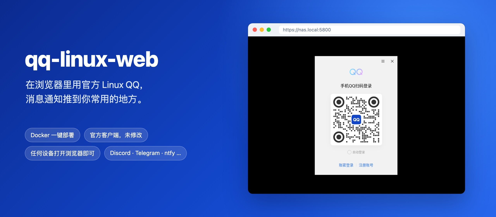
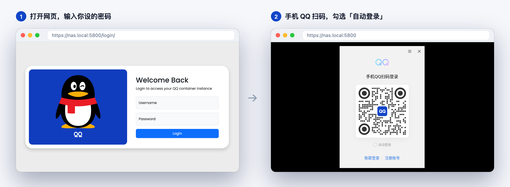
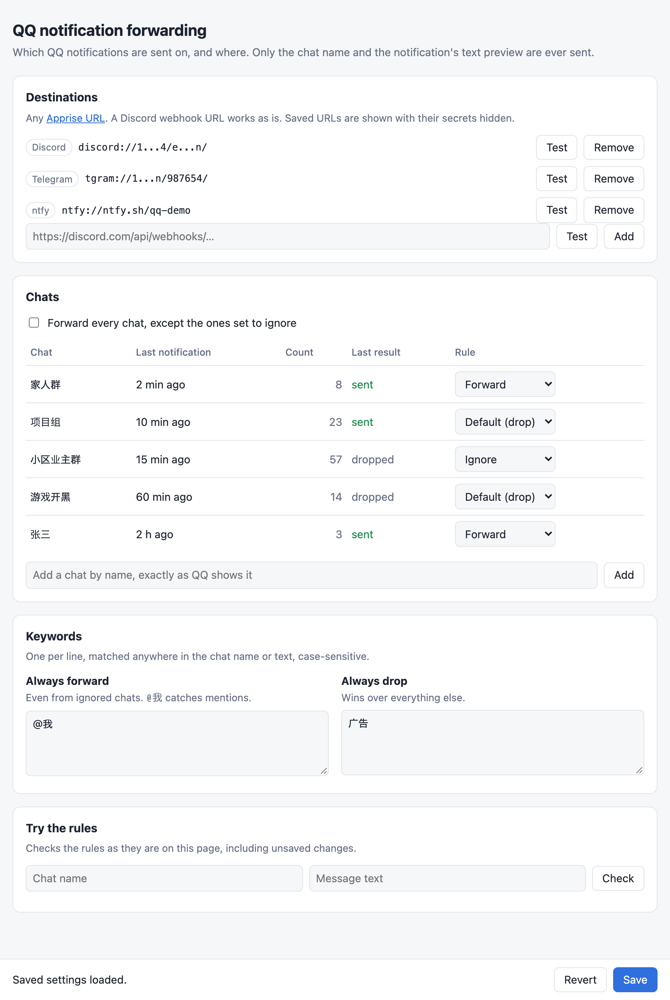
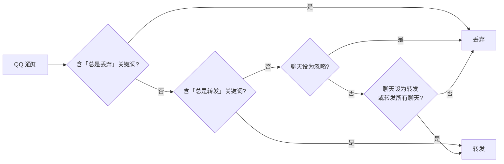
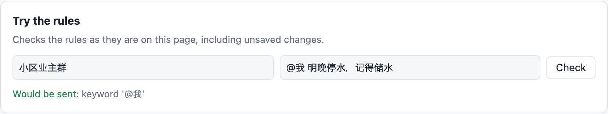
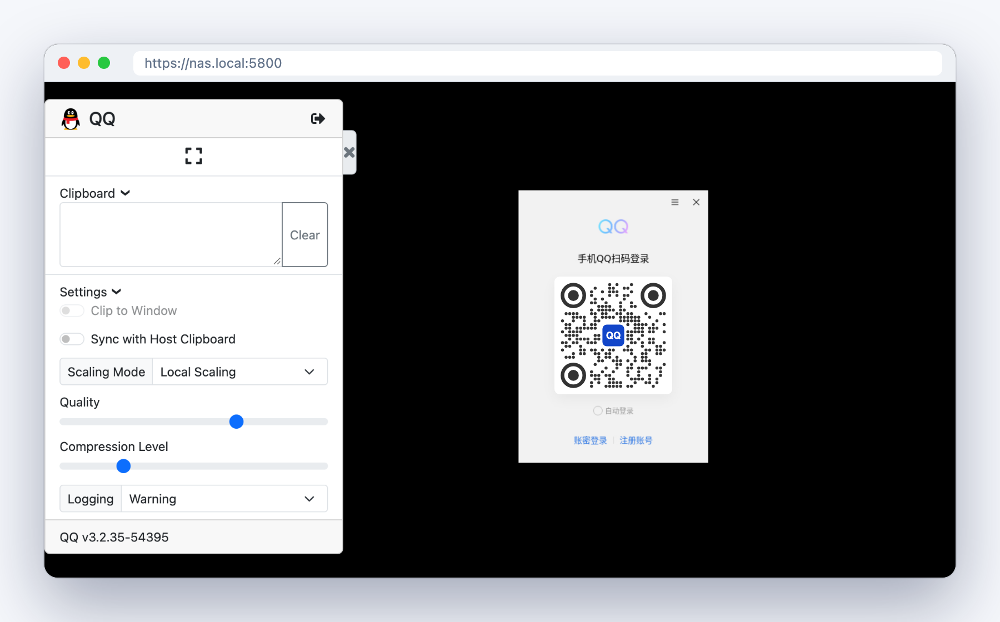
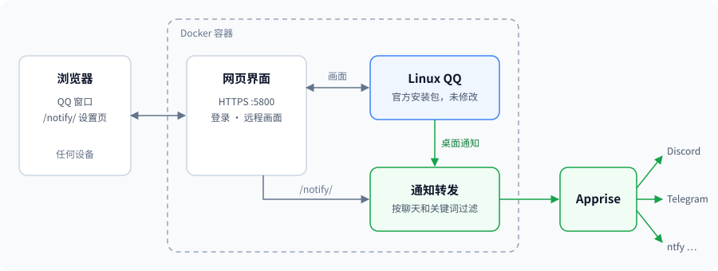

<h1 align="center"></h1>

在 Docker 里运行官方 Linux QQ，用浏览器访问，并把 QQ 通知转发到 Discord、Telegram、ntfy 等服务。

- 腾讯发布的 Linux QQ 安装包，未做修改。
- 网页界面基于 [jlesage/baseimage-gui](https://github.com/jlesage/docker-baseimage-gui)，只显示 QQ 窗口，可开启用户名密码登录。
- 通知转发到任何 [Apprise](https://github.com/caronc/apprise) 支持的服务，按聊天和关键词过滤。
- CI 每周检查 QQ 新版本，测试通过后发布新镜像。

## 快速开始

1. 准备目录，生成固定的 machine-id：

   ```bash
   mkdir qq && cd qq
   cat /proc/sys/kernel/random/uuid | tr -d - > machine-id
   ```

2. 下载 [`docker-compose.yml`](docker-compose.yml)，改掉 `WEB_AUTHENTICATION_PASSWORD`，然后启动：

   ```bash
   docker compose up -d
   ```

3. 打开 `https://服务器IP:5800`。证书是自签名的，浏览器提示不安全时继续访问即可。

4. 登录网页后用手机 QQ 扫码。**记得勾选「自动登录」**，容器重启后就不用再扫码。



## 保持登录

QQ 根据 MAC 地址和 machine-id 判断是否换了设备，所以 `docker-compose.yml` 固定了这两样。`mac_address` 随便写一个不和局域网冲突的值，`machine-id` 文件不要删。迁移时把 `data` 目录、`machine-id` 和 MAC 地址一起带走。

QQ 设置里还有跳过手机确认的选项，和「自动登录」一起开启后，重启一般不用手机确认。这个选项偶尔会被关掉，重新打开即可。

## 通知转发

设置页在 `https://服务器IP:5800/notify/`，和 QQ 共用同一个登录。



- **推送地址**：填 [Apprise URL](https://github.com/caronc/apprise/wiki)，Discord Webhook 地址可直接粘贴。保存后不再显示密钥，每个地址可单独测试。
- **聊天**：列出发过通知的聊天，逐个设为转发、忽略或默认，也可以转发所有聊天。
- **关键词**：「总是转发」如 `@我`，被 @ 时即使在忽略的群里也会转发；「总是丢弃」如 `广告`。



规则从上到下检查，第一条匹配的生效。「试一试」可以检查规则，未保存的修改也算：



设置保存在 `data/notify-forward.json`，直接编辑也会立即生效，不用重启。

需要知道的几点：

- 只转发聊天名和一小段文字预览，不转发图片和文件，不读取聊天记录。
- 在 QQ 里设为免打扰的群不弹通知，也就不会转发。
- 有人打开网页时 QQ 正常显示，不发通知；网页全部关掉 10 秒后才开始转发。
- 只能单向转发，不能从 Discord 等地方回复。

## 环境变量

| 变量 | 说明 | 默认值 |
|---|---|---|
| `USER_ID` / `GROUP_ID` | 运行 QQ 的用户和组，决定 `data` 目录的文件归属 | `1000` |
| `TZ` | 时区 | `Etc/UTC` |
| `WEB_AUTHENTICATION` | 设为 `1` 开启网页登录 | `0` |
| `WEB_AUTHENTICATION_USERNAME` / `WEB_AUTHENTICATION_PASSWORD` | 网页登录的用户名和密码 | 无 |
| `SECURE_CONNECTION` | 网页使用 HTTPS，通知转发需要，请保持开启 | `1` |
| `WEB_NOTIFICATION` | 接收 QQ 通知，通知转发需要，请保持开启 | `1` |

其他选项（分辨率、深色模式等）见 [jlesage/baseimage-gui](https://github.com/jlesage/docker-baseimage-gui)。

## 反向代理

5800 端口是 HTTPS（自签名证书），代理连后端要用 `https` 并跳过证书校验，还需要支持 WebSocket。Traefik 示例：

```yaml
labels:
  - traefik.http.services.qq.loadbalancer.server.port=5800
  - traefik.http.services.qq.loadbalancer.server.scheme=https
```

并开启 `--serversTransport.insecureSkipVerify=true`。

## 更新

```bash
docker compose pull && docker compose up -d
```

登录状态和聊天记录在 `data` 目录里，不会丢。

## 常见问题

**怎么输入中文？** 容器里没有输入法，在电脑上打好字，用网页侧边栏的剪贴板粘贴。



**和 linuxserver 的 webtop 有什么区别？** webtop 是完整桌面，这里只运行 QQ，另带通知转发。

**会被封号吗？** 运行的是未修改的官方客户端，和在 Linux 电脑上登录一样，但无法保证腾讯以后的策略。

**支持 ARM 吗？** 暂时只有 x86_64（amd64）。

## 开发



`mise install` 装好工具链。转发程序和设置页在 `src/qq_notify_forward/`，测试在 `tests/`（pytest 单元测试、Playwright 浏览器测试、需要 Docker 的冒烟测试）。

```bash
uv sync
uv run pytest
uv run ruff check src tests

bun install
bun --bun x playwright install chromium
bun run test:e2e

docker build -t qq-linux-web:dev .
tests/smoke-test.sh qq-linux-web:dev
```

不启动 QQ 也能调设置页：`uv run qq-notify-forward serve --settings /tmp/s.json --chats /tmp/c.json`，然后打开 `http://127.0.0.1:8081/`。

镜像里的 Python 依赖来自 Ubuntu 24.04 的 apt，`pyproject.toml` 里的版本要和 apt 保持一致。

## 声明

本项目与腾讯无关。QQ 是腾讯公司的软件和商标，镜像中包含的是从腾讯官网下载、未经修改的 Linux QQ 安装包。本仓库的代码使用 MIT 许可证，不包括 QQ 本身。请仅用于个人用途，并遵守 QQ 的用户协议。
